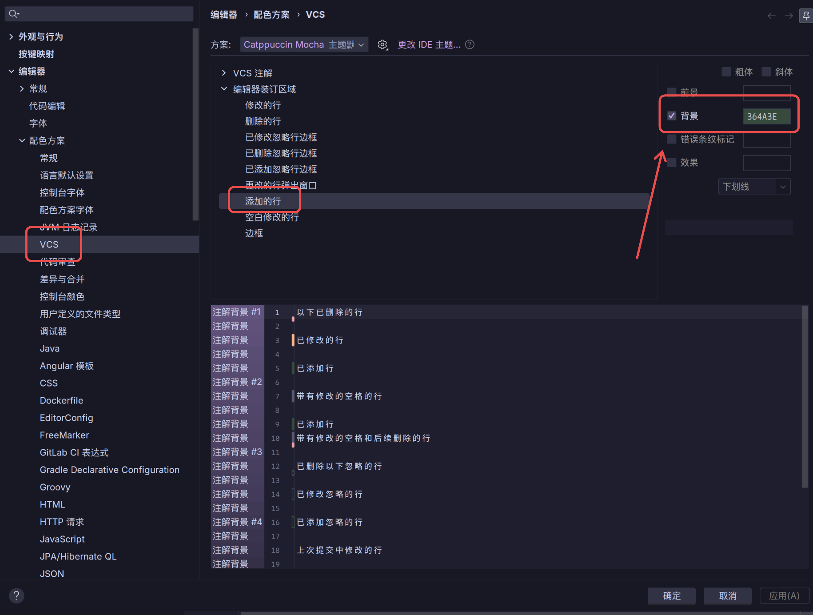

最近用 IDEA 的“提取参数”功能时，遇到了一个小问题：新增参数的背景是浅绿色，文字也是浅色，两种颜色凑在一起，实在有点看不清。

我用的是 **Catppuccin Mocha** 主题，其他地方的配色都挺舒服，不想为了这一处换掉整个主题。把这块背景调深一点就行，顺手记一下修改位置。

## 要改的是 VCS 配色

这个设置不在“实时模板”里，也不是“差异与合并”里的“已插入”。真正要改的是这里：

**设置 → 编辑器 → 配色方案 → VCS → 编辑器装订区域（Editor Gutter）→ 添加的行（Added lines）**

有的版本可能叫“新增行”，看英文的 **Added lines** 就好。

选中后，把右侧的**背景**颜色改成 `#364A3E`，也就是一个深一点的绿色。

点击“应用”，再触发一次“提取参数”检查效果。如果当前主题的配色方案不能直接修改，先复制一份，再改复制出来的方案。

## 顺带会影响 Git 的行标记

“提取参数”的背景高亮复用了 `ADDED_LINES_COLOR`，也就是 VCS 的新增行颜色。所以虽然改的是 VCS 配色，它也会影响这里的高亮。

这也意味着，**编辑器左侧 Git 新增行的标记会一起变成这个深绿色**，不是只改“提取参数”这一处。

改动不大，但至少提取参数的时候不用费劲辨认文字了。记在这里，下次换主题又碰到类似情况，也省得重新找。
